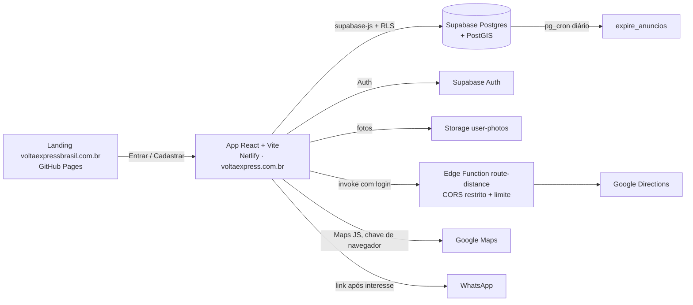

# Arquitetura de Software — Volta Express Brasil

> Atualizada em set/2026, após P1, P1.1, P2, P3, R1, Match v2 e DS1–DS6.

## 1. Contexto do negócio
Marketplace de frete rodoviário com duas personas que anunciam uma para a outra:
- **Caminhoneiro** (`tipo_usuario = 'C'`): anuncia veículo e rota (`tipo_anuncio = 'V'`) e busca cargas para não rodar vazio.
- **Empresa** (`tipo_usuario = 'E'`): anuncia carga (`tipo_anuncio = 'C'`) e busca veículos.
A plataforma conecta e registra o interesse; a negociação é direta, pelo WhatsApp.

## 2. Visão geral

## 3. Stack
| Camada | Tecnologia |
|---|---|
| Front | React 18, TypeScript, Vite 5, Tailwind, shadcn/ui, React Router 6 (rotas sob demanda), framer-motion |
| Back | Supabase: Postgres + RLS + PostGIS, Auth, Storage, Edge Functions (Deno), pg_cron |
| Mapas | Google Directions (servidor) e Maps JS (navegador) |
| Qualidade | Vitest + Testing Library (13 testes), ESLint, TypeScript |
| Hospedagem | Netlify (app), Supabase (dados), GoDaddy (domínio) |

## 4. Módulos do front
| Módulo | Arquivos | Responsabilidade |
|---|---|---|
| Rotas | `src/App.tsx`, `components/ProtectedRoute.tsx` | Rotas públicas/protegidas, carregamento sob demanda, `MotionConfig reducedMotion="user"` |
| Auth | `contexts/AuthContext.tsx`, páginas de login/cadastro/senha | Sessão Supabase |
| Anúncios | `lib/anuncio-service.ts`, `pages/CriarAnuncio.tsx`, `pages/Buscar.tsx` | Criação transacional com rota, listagem, status, interesse |
| Rota | `lib/rota-service.ts` | Chamada à Edge Function e leitura da resposta |
| Match | `lib/matching-service.ts`, `pages/Matching.tsx` | Entrada das funções de match, rota digitada, resultado com score |
| Painel | `pages/Painel.tsx` | Indicadores (telemetria) e gestão dos próprios anúncios |
| Componentes do anúncio | `components/AnuncioCard.tsx`, `AnuncioDetailDialog.tsx`, `components/anuncio/*` | Card v2, score, motivos, anunciante, botão de interesse |
| Formatos | `lib/formatos.ts` | Datas, pesos, valores, iniciais |
| Tokens de design | `src/index.css`, `tailwind.config.ts` | Cores da marca (alinhadas à landing) com contraste AA |

## 5. Modelo de dados
| Tabela | Papel | Observação |
|---|---|---|
| `vt_usuario` | Perfil 1:1 com `auth.users` | Cada usuário lê só o próprio perfil (P1) |
| `vt_veiculo` / `vt_carroceria` | Veículo e carroceria | Reaproveitado pela placa; leitura de terceiros só para logados (P1.1) |
| `vt_mercadoria` | Carga | + `categoria_carga`, `exige_refrigeracao`, `user_id` |
| `vt_localizacao` | Cidade/UF + coordenadas | Coordenadas preenchidas a partir da rota |
| `vt_anuncio` | Anúncio V ou C | + `rota` (PostGIS), `distancia_km`; status ATIVO/PAUSADO/ENCERRADO/EXPIRADO |
| `vt_compatibilidade` | Regra carga × carroceria | Editável sem deploy |
| `vt_match_config` | Pesos e parâmetros do score | Editável sem deploy |
| `vt_match_evento` | Exibições e contatos | Base de métricas e do painel |

## 6. Funções no banco
| Função | Tipo | Quem chama |
|---|---|---|
| `vt_criar_anuncio(p)` | INVOKER (RLS vale) | Criar anúncio |
| `vt_match_cargas(p)` / `vt_match_veiculos(p)` | DEFINER, só logado | Matching |
| `vt_registrar_interesse(anuncio, score)` | DEFINER, só logado | Botão "Tenho interesse" |
| `vt_anunciantes(ids)` | DEFINER, só logado | Nome e foto nos cards |
| `vt_meu_painel()` | DEFINER, só logado | Painel |
| `expire_anuncios()` | agendada (pg_cron 03:05 UTC) | Automático |

## 7. Fluxos principais
1. **Cadastro:** `auth.signUp` → trigger cria `vt_usuario`.
2. **Criar anúncio:** origem/destino preenchidos → `route-distance` devolve polyline, coordenadas e distância → `vt_criar_anuncio` grava tudo numa transação.
3. **Match:** formulário → rota digitada (quando possível) → função de match no banco → resultados com score e motivos → evento `exibido`.
4. **Contato:** "Tenho interesse" → `vt_registrar_interesse` (evento `contato`) → abre o WhatsApp.

## 8. Segurança
- RLS em todas as tabelas; dados de contato só por funções que exigem login.
- Edge Functions: CORS só para `voltaexpress.com.br` e `localhost:8080` (variável `ALLOWED_ORIGINS`), login obrigatório, limite de 30 chamadas/min por usuário e validação de entrada (`supabase/functions/_shared/seguranca.ts`).
- Chave do Google no servidor como segredo; chave do navegador via `VITE_GOOGLE_MAPS_BROWSER_KEY`, restrita por domínio.

## 9. Limitações conhecidas
Ver [ROADMAP.md](ROADMAP.md).
